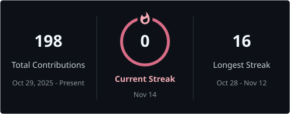
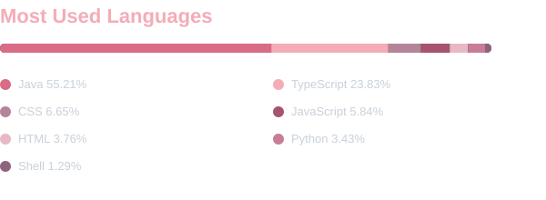

<h1 align="center">Hi, I'm Kristine! </h1>

  

  

  <b>BSIT student · Mobile &amp; Web Applications · Philippines</b> 
  A little space for the things I'm building and learning along the way.

## A Little About Me

I'm a second-year **BS Information Technology** student specializing in **Mobile & Web Applications** at **National University – MOA**.

I enjoy turning lessons into projects I can actually use—from Pokémon-themed Java applications to a personal digital scrapbook. I like giving those projects a thoughtful interface and a bit of personality while figuring out how everything works behind the scenes.

This profile is where I share that progress, including the small projects that help me try something new.

## A Few Things I've Made

| Project | A little about it | Explore |
| --- | --- | --- |
| **A Little Somewhere** | A personal digital scrapbook for journaling, planning, reflection, and everyday memories. | [Try it online](https://alittlesomewhere.vercel.app/) |
| **Pokémon Priority Battle Arena** | A Java console-based Pokémon battle simulator built for a Data Structures and Algorithms project. Uses a custom max-heap to prioritize battle actions based on move priority, Pokémon speed, and action order. | [Repository](PASTE_POKEMON_ARENA_REPOSITORY_LINK_HERE) |
| **Vantage – Portfolio Management System** | A Java Swing desktop application designed to help users organize and manage their portfolios. Contributed as one of the two coders, working on implementing the application's features and interface. | [Repository](https://github.com/cymriccc/Portfolio-Management-System) |
| **SecurePass** | A JavaScript practice project for generating random password options with adjustable length and character toggles. | [Repository](https://github.com/tineetot/Password-Generator) |

## Languages & Tools

Tools I'm using and learning through coursework and personal projects.

  
  
  
  
  
  
  
  
  
  
  

## GitHub Stats & Streaks

  
  

  

## Little Contributions Add Up

<picture>
  <source media="(prefers-color-scheme: dark)" srcset="https://raw.githubusercontent.com/tineetot/tineetot/output/snake-dark.svg" />
  <source media="(prefers-color-scheme: light)" srcset="https://raw.githubusercontent.com/tineetot/tineetot/output/snake.svg" />
  
</picture>

 

