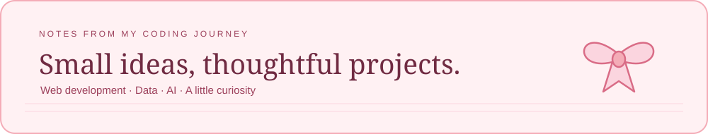
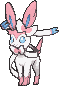
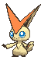

  

<h1 align="center">Hi, I'm Kristine 🎀</h1>

  

  

  <b>BSIT student · Mobile &amp; Web Applications · Philippines</b> 
  A little space for the things I'm building and learning along the way.

## A Little About Me

I'm a second-year **BS Information Technology** student specializing in **Mobile & Web Applications** at **National University – MOA**.

I enjoy turning lessons into projects I can actually use—from Pokémon-themed Java applications to a personal digital scrapbook. I like giving those projects a thoughtful interface and a bit of personality while figuring out how everything works behind the scenes.

This profile is where I share that progress, including the small projects that help me try something new.

## What I'm Exploring

| Area | Currently learning and building |
| --- | --- |
| **Data & AI** | Learning Python, data science, and machine learning foundations through GCI World and DataCamp. |
| **Java & DSA** | Building a terminal-based Pokémon battle simulator with a custom max-heap to order battle actions. |
| **Web Development** | Creating responsive projects with React, Vite, JavaScript, HTML, and CSS. |
| **Learning in Public** | Sharing projects and lessons as I go, even while I'm still figuring things out. |

## A Few Things I've Made

| Project | A little about it | Explore |
| --- | --- | --- |
| **A Little Somewhere** | A personal digital scrapbook for journaling, planning, reflection, and everyday memories. | [Try it online](https://alittlesomewhere.vercel.app/) |
| **Pokémon: Moonveil** | A Java Swing application with registration, login, profile settings, and a Pokédex-style dashboard. | [Repository](https://github.com/tineetot/Java-GUI-Application-Pokemon-Moonveil) |
| **SecurePass** | A JavaScript practice project for generating random password options with adjustable length and character toggles. | [Repository](https://github.com/tineetot/Password-Generator) |

## Languages & Tools

Tools I'm using and learning through coursework and personal projects.

  
  
  
  
  
  
  
  
  
  
  

## Little Contributions Add Up

<picture>
  <source media="(prefers-color-scheme: dark)" srcset="https://raw.githubusercontent.com/tineetot/tineetot/output/snake-dark.svg" />
  <source media="(prefers-color-scheme: light)" srcset="https://raw.githubusercontent.com/tineetot/tineetot/output/snake.svg" />
  
</picture>

## Let's Connect

  
  

 

   
  <i>Still learning, still building, celebrating the little wins.</i>

<!-- Pokémon sprites: PokeAPI/sprites, animated sprites by the Smogon community.
     Typing animation: DenverCoder1/readme-typing-svg.
     Contribution animation: Platane/snk. -->
